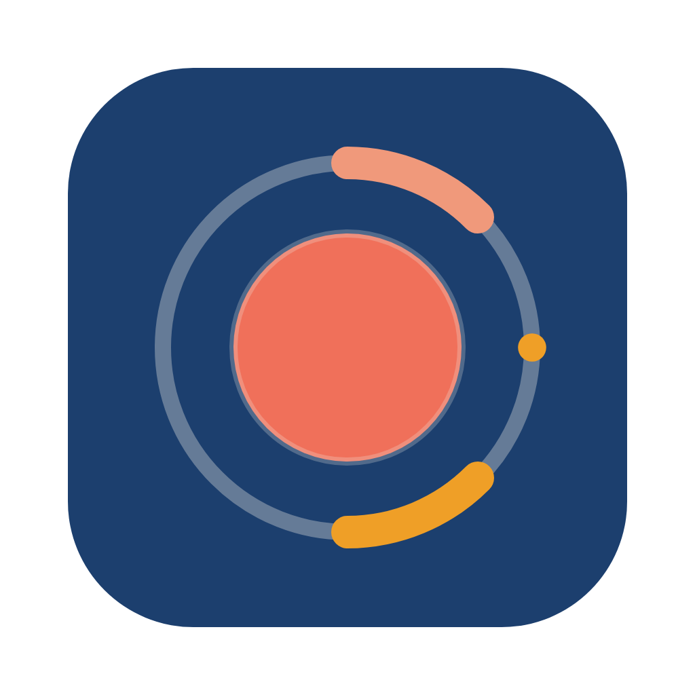

<p align="center">
  
</p>

<h1 align="center">Screenova</h1>

<p align="center">
  Grabador de pantalla, cámara y micrófono para macOS<br>
  <sub>by <a href="https://oxdabit.com"> <b>0xDA</b> bit</a></sub>
</p>

<p align="center">
  
  
  
  
</p>

Quería algo con el flujo de Loom (eliges qué grabar, aparece tu cara en una burbuja, grabas y lo tienes listo) pero sin cuentas, sin nube y con mi estética. Screenova guarda todo en tu Mac: no sube nada a ningún sitio.

## Qué hace en esta versión (0.1.1)

### Grabar

- **Tres modos:** pantalla + cámara, solo pantalla o solo cámara.
- **Qué grabar:** cualquier pantalla o ventana, elegida desde una cuadrícula con miniaturas.
- **Burbuja de cámara:** circular, flotante y arrastrable, en tres tamaños (S, M y L). Sale en el vídeo, como en Loom.
- **Micrófono:** selector de dispositivo con medidor de nivel para comprobar que te oye antes de empezar.
- **Cuenta atrás** de 3 segundos con aviso sonoro.
- **Barra de control flotante:** pausar, reanudar, volver a empezar, descartar y detener. Ni la barra ni la cuenta atrás aparecen en el vídeo.
- **Atajos globales:** `⌥⇧R` empieza o detiene, `⌥⇧P` pausa o reanuda.
- **Icono en la barra de menús** con las mismas acciones, para no tener que volver a la ventana principal.

### Biblioteca

- Lista de grabaciones con miniatura, duración, fecha y modo.
- Título editable: haz clic en él dentro del reproductor.
- **Menú de tres puntos** en cada tarjeta (o clic derecho): abrir, renombrar, exportar a MP4, mostrar en Finder y mover a la papelera.
- Borrar mueve los archivos a la Papelera de macOS, así que se puede deshacer desde Finder.

### Reproducir, recortar y exportar

- **Pantalla completa** con el botón del reproductor o con doble clic sobre el vídeo.
- **Recorte no destructivo:** arrastra los tiradores o usa *Inicio aquí* y *Fin aquí* desde la posición actual. El archivo original no se toca; el recorte se aplica al reproducir y al exportar.
- **Exportar a MP4** (H.264 + AAC). Sin recorte, se copia el vídeo tal cual en un momento; con recorte, se recodifica con el codificador por hardware del Mac.

## Cómo funciona

Screenova es una app de [Electron](https://www.electronjs.org/). Una grabación pasa por estos pasos:

1. **Biblioteca** (`library.html`): eliges modo, fuente, cámara y micrófono. Las opciones se recuerdan para la próxima vez.
2. **Proceso principal** (`src/main/main.js`): abre la burbuja de cámara, la barra de control y la cuenta atrás. A la vez prepara una **ventana oculta de grabación** (`recorder.html`), que es la que captura.
3. **Grabación:** la ventana oculta une el vídeo (pantalla o cámara) y el audio del micrófono en un `MediaRecorder`. Cada segundo envía un trozo al proceso principal, que lo escribe en disco. Así una grabación larga nunca tiene que caber en memoria.
4. **Guardado:** al detener, `ffmpeg` reordena el archivo sin recodificarlo para que tenga duración e índice de búsqueda, y saca una miniatura. Después se escriben los metadatos (`.json`) y la grabación se abre en el reproductor.

La burbuja de cámara es una ventana transparente siempre encima: aparece en el vídeo porque está en la pantalla que se graba. La barra de control y la cuenta atrás, en cambio, están marcadas para que macOS las excluya de la captura.

### Rendimiento

La primera versión grababa en VP9 a la resolución completa de la pantalla, y en un MacBook Pro con Intel i7-9750H y pantalla Retina de 3072 × 1920 la app se volvía inutilizable. Lo medí con una prueba de codificación sintética, sumando el uso de CPU de todos los procesos de la app (100 % es un núcleo completo):

| Configuración | CPU |
|---|---|
| VP9 a 3072 × 1920 (primera versión) | ~344 %, y el codificador no daba abasto |
| H.264 por hardware a 3072 × 1920 | ~65 % |
| H.264 por hardware a 1920 × 1200 (actual) | ~42 % |

Por eso ahora:

- Se graba en **H.264 por hardware (VideoToolbox) en MP4**. VP8 y VP9 solo se usan si H.264 no está disponible, y entonces se guarda `.webm`.
- La pantalla se captura como máximo a **1920 × 1200 y 30 fps**.
- La barra de control solo se redibuja cuando cambia el contador, no a cada fotograma.

## Requisitos

- **macOS.** Lo he probado en macOS 26 con un Mac Intel. Los Mac con Apple Silicon deberían funcionar, pero no los he probado.
- **Node.js** 22.23.4 o posterior, o 24.22.1 o posterior.
- **Xcode o sus herramientas de línea de comandos** (`swiftc`), solo para empaquetar la app.

## Probarla en modo desarrollo

```bash
npm install
npm start
```

`npm install` descarga Electron y un `ffmpeg` precompilado. Sus scripts de instalación están autorizados en `allowScripts` de `package.json`.

> **Ojo con los permisos en modo desarrollo:** con `npm start`, macOS asigna los permisos de cámara, micrófono y grabación de pantalla a la app desde la que lanzas el comando (Terminal, iTerm, VS Code…), no a Screenova. Para usarla en el día a día, mejor la app empaquetada.

## Crear Screenova.app

```bash
npm run package
```

El script:

1. Compila el ayudante nativo `native/screen-access.swift` (ver más abajo).
2. Empaqueta la app con su icono y la firma localmente.
3. La instala en `~/Applications/Screenova.app`.

La firma es local ("ad hoc"): vale para tu Mac, pero no para repartir la app (para eso hace falta un certificado de Apple Developer y notarizarla). Está fijada al identificador `com.oxdabit.screenova`, y no a la huella del binario, para que macOS no olvide los permisos cada vez que vuelves a empaquetar.

## Permisos de macOS

La primera vez que abras **Nueva grabación**, macOS te pedirá permiso para grabar la pantalla. Al grabar te pedirá también la cámara y el micrófono.

**Después de activar la grabación de pantalla hay que cerrar la app (⌘Q) y volver a abrirla.** macOS no aplica ese permiso hasta que la app se reinicia.

En las versiones recientes de macOS, Electron no muestra el aviso de grabación de pantalla: la captura falla sin más y la app nunca llega a aparecer en la lista de Ajustes. Para evitarlo, Screenova incluye un ayudante nativo muy pequeño, `screen-access`, que llama a `CGRequestScreenCaptureAccess()`. Como lo lanza la propia app, macOS atribuye la petición a Screenova.

Si el interruptor de Screenova aparece activado en Ajustes pero la app sigue diciendo que no tiene permiso, la entrada es de una versión anterior. Ciérrala, borra su permiso y vuelve a abrirla:

```bash
tccutil reset ScreenCapture com.oxdabit.screenova
```

## Windows

```bash
npm run dist:win
```

Genera en `dist/` el instalador `Screenova-Setup-<versión>.exe` y una versión portable `Screenova-<versión>-win-x64.zip`. Hay que ejecutarlo en Windows (o en GitHub Actions, ver más abajo), porque `npm install` descarga el ffmpeg del sistema donde se instala.

Diferencias con macOS:

- No hace falta permiso para grabar la pantalla. La cámara y el micrófono se controlan en **Configuración › Privacidad y seguridad**.
- Los botones de minimizar, maximizar y cerrar se superponen a la derecha de la barra superior.
- El icono vive en la bandeja del sistema: un clic abre la biblioteca y el clic derecho muestra el menú. Cerrar la ventana no cierra la app; para salir, usa **Salir de Screenova** en ese menú.
- Los atajos son `Alt+Shift+R` (empezar / detener) y `Alt+Shift+P` (pausa).
- La barra de control no sale en el vídeo en Windows 10 (versión 2004 o posterior) y Windows 11.
- La exportación usa el codificador por hardware de Media Foundation (`h264_mf`) y, si no está disponible, x264.
- El instalador no está firmado: la primera vez Windows SmartScreen muestra «Windows protegió su PC». Pulsa **Más información › Ejecutar de todas formas**.

## Validación en GitHub Actions

El flujo [`.github/workflows/multiplatform.yml`](.github/workflows/multiplatform.yml) se ejecuta en cada push a `multiplaform-test` y `multiplaform-test-*`. En una máquina Windows real:

1. Instala las dependencias y comprueba la sintaxis (`npm run check`).
2. Genera el instalador (`npm run dist:win`).
3. Abre la app empaquetada en modo de autocomprobación (`SCREENOVA_SMOKE=<informe.json>`), que no graba nada y revisa: ffmpeg y la exportación (con el codificador usado), los formatos de `MediaRecorder`, que el sistema ofrece pantallas para capturar, que la biblioteca carga sin errores y con los textos de la plataforma, y el icono de la bandeja.
4. Sube el instalador, el `.zip` y el informe como artefacto descargable del run.

Para probar la autocomprobación en local:

```bash
SCREENOVA_SMOKE="$PWD/smoke.json" npx electron .
```

## Dónde se guardan los vídeos

En `~/Movies/Screenova/` en macOS y en la carpeta **Vídeos\Screenova** del usuario en Windows. Cada grabación son tres archivos con el mismo identificador:

- `<id>.mp4`: el vídeo (`.webm` si se grabó con el códec alternativo).
- `<id>.jpg`: la miniatura.
- `<id>.json`: título, fecha, duración, modo y recorte.

## Scripts

| Script | Qué hace |
|---|---|
| `npm start` | Abre la app en modo desarrollo |
| `npm run package` | Crea, firma e instala `~/Applications/Screenova.app` |
| `npm run dist:win` | Genera el instalador y la versión portable de Windows en `dist/` |
| `npm run check` | Comprueba la sintaxis de todos los archivos JavaScript |
| `npm run icons` | Regenera los iconos de la app y de la barra de menús a partir de `assets/mark.svg` |

## Estructura del proyecto

```
src/main/
  main.js          ventanas, sesión de grabación, permisos, IPC y barra de menús
  store.js         biblioteca en disco (~/Movies/Screenova)
  media.js         remux, miniaturas y exportación a MP4 con ffmpeg
  preload.js       API mínima, con lista blanca de canales, para las ventanas
  brand.js         nombre de la app y atajos de teclado
  platform.js      textos y ajustes que cambian entre macOS, Windows y Linux
  smoke.js         autocomprobación para CI (SCREENOVA_SMOKE)
src/renderer/
  library.*        biblioteca, panel de nueva grabación y reproductor
  recorder.*       ventana oculta que captura y graba
  bubble.*         burbuja de cámara
  controls.*       barra de control flotante
  countdown.*      cuenta atrás
  brand.css        colores y tipografías de 0xDA bit
native/
  screen-access.swift   ayudante que pide el permiso de grabación de pantalla
assets/
  mark.svg         logo de Screenova
  isotipo.svg      isotipo de 0xDA bit
  icon.*, trayTemplate*.png   iconos de macOS generados con `npm run icons`
  icon-square.png, tray*.png  iconos de Windows y Linux, generados igual
scripts/
  package.mjs      empaquetado, firma e instalación
  build-native.mjs compila el ayudante nativo
  build-icons.js   genera los iconos
```

## Limitaciones conocidas

- **macOS y Windows.** Linux (Ubuntu) está pendiente de adaptar en la rama `multiplaform-test-ubuntu`.
- **No graba el audio del sistema**, solo el micrófono.
- **No hay enlaces para compartir:** todo se queda en local. Para compartir, exporta el MP4.
- **App sin notarizar:** la firma local solo sirve en el Mac donde se empaqueta.

## Licencia

El código está bajo licencia [MIT](LICENSE): puedes usarlo, modificarlo y redistribuirlo manteniendo el aviso de copyright.

Quedan fuera de esa licencia el nombre e isotipo de **0xDA** bit y el nombre, logo e iconos de Screenova (`assets/isotipo.svg`, `assets/mark.svg` y los iconos generados). Si publicas una versión modificada, usa tu propio nombre y tus propios gráficos.

La app empaquetada incluye un binario de ffmpeg con licencia GPL. Si la redistribuyes, revisa las condiciones de [`ffmpeg-static`](https://github.com/eugeneware/ffmpeg-static).

## Créditos

- Diseño con la identidad de **0xDA_bit**: tipografías [Epilogue](https://fonts.google.com/specimen/Epilogue) y [Sometype Mono](https://fonts.google.com/specimen/Sometype+Mono), servidas en local con Fontsource.
- Vídeo con [ffmpeg](https://ffmpeg.org/), incluido mediante [`ffmpeg-static`](https://github.com/eugeneware/ffmpeg-static).

---

<p align="center">
  <a href="https://oxdabit.com"></a>
</p>

<p align="center">
  <b>0xDA</b> bit · <i>Del boceto al plato</i><br>
  <sub><a href="https://oxdabit.com">oxdabit.com</a> · <a href="https://www.youtube.com/@0xDAbitLabs">YouTube</a> · <a href="https://github.com/OxDAbit">GitHub</a> · <a href="https://x.com/0xDA_bit">X</a> · <a href="https://www.instagram.com/oxdabitlabs/">Instagram</a></sub>
</p>
